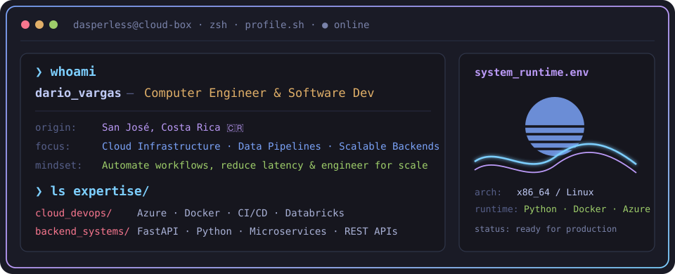

 

 

 

---

## `$ whoami`

  

---

## `$ cat tech-stack.yaml`

<table border="1" cellpadding="14" bgcolor="#1a1b26">
  <thead>
    <tr>
      <th colspan="2" align="left"><code>dasperless:~$ cat tech-stack.yaml</code></th>
    </tr>
  </thead>
  <tbody>
    <tr>
      <td width="50%" valign="top"><code>├─ ☁ cloud_infrastructure:</code>  
         
        <code>Azure · Docker · GitHub Actions · Linux · Databricks</code>
      </td>
      <td width="50%" valign="top"><code>├─ ▣ databases_storage:</code>  
         
        <code>Cosmos DB · MongoDB · PostgreSQL · SQLite</code>
      </td>
    </tr>
    <tr>
      <td valign="top"><code>├─ ✦ languages_core:</code>  
         
        <code>Python · TypeScript · JavaScript · Go · C# · C++</code>
      </td>
      <td valign="top"><code>╰─ ⚙ frameworks_tooling:</code>  
         
        <code>FastAPI · React · Node.js · Angular · Postman · Git</code>
      </td>
    </tr>
  </tbody>
  <tfoot>
    <tr>
      <td colspan="2"><code>status: ready&nbsp;&nbsp;·&nbsp;&nbsp;environment: production&nbsp;&nbsp;·&nbsp;&nbsp;uptime: 99.9%</code></td>
    </tr>
  </tfoot>
</table>

---

## `$ systemctl status analytics`

  
  

  

---

## `$ ssh connect@dasperless`

&nbsp;&nbsp;
&nbsp;&nbsp;
&nbsp;&nbsp;

 

  <code>echo "Built with passion &amp; caffeine from San José, Costa Rica 🇨🇷 · @Dasperless"</code>

